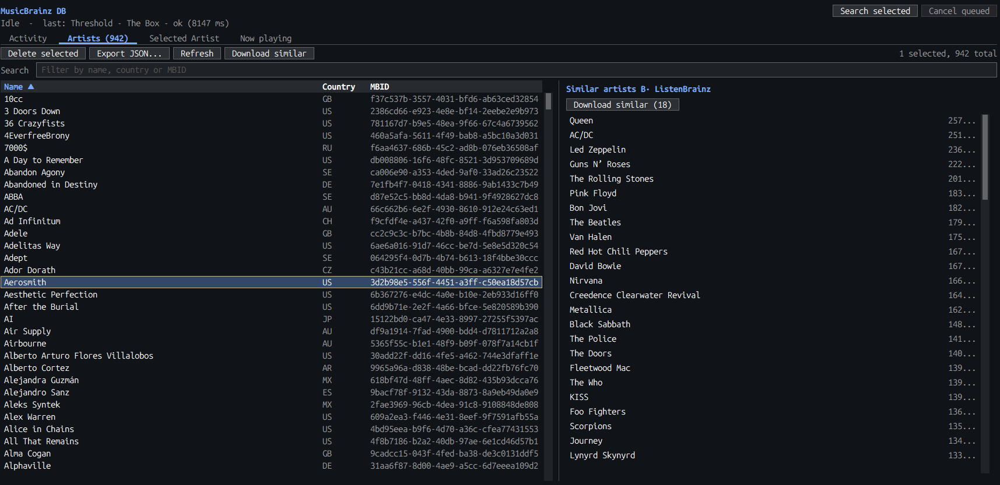
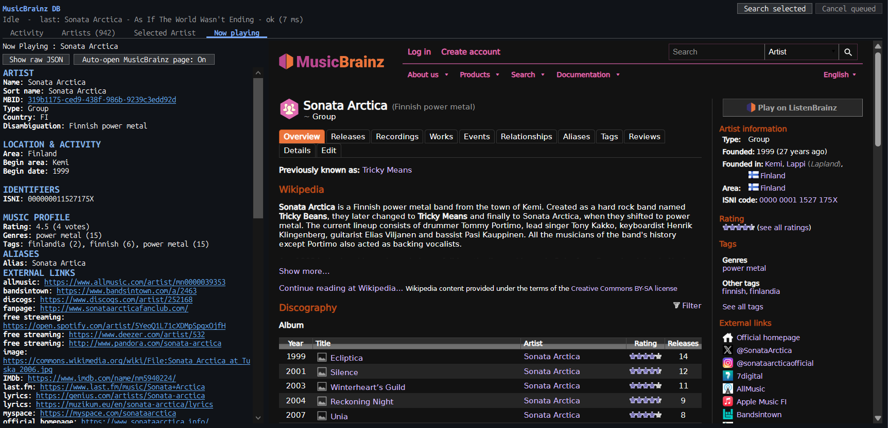
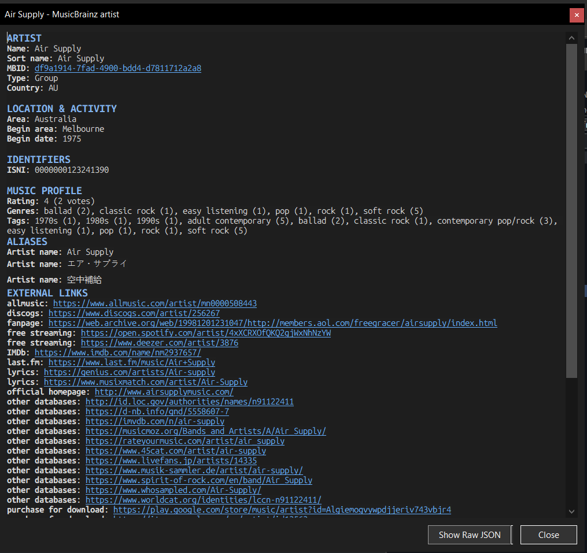

# foo_musicbrainz_db

A foobar2000 component that quietly builds and maintains a local MusicBrainz artist database while you listen. It looks up artists when tracks start or when radio streams publish new track metadata, then caches complete artist records in SQLite and exports them to JSON files.


## Features

### Automatic artist collection

- **Playback-triggered lookups.** A lookup is queued when a new track starts. The component also handles dynamic track metadata, which is commonly used by Shoutcast/Icecast streams.
- **MusicBrainz ID tags take priority.** A valid UUID in `MUSICBRAINZ_ARTISTID` or `MUSICBRAINZ ARTIST ID` is used directly; no artist/title search is needed.
- **Known artists are matched by name next.** Without an ID tag, an artist already stored in the database under exactly that name (case-insensitive) is used and MusicBrainz is not queried. If several stored artists share the name, the MusicBrainz searches below decide.
- **Search fallback.** Without an ID, the component searches by recording title and artist, then falls back to an artist-name search. Results of both searches are accepted only when the artist's name, or one of its aliases, matches the tagged artist name (case-insensitive); a credited-as name also counts for the title search.
- **Combined stream titles.** If no artist tag is available, a title in `Artist - Title` form is split into artist and title.
- **Custom tag expressions.** Artist and title can be sourced from user-defined foobar2000 title-formatting patterns instead of the plain `%artist%` and `%title%` metadata fields.
- **Stream metadata settling delay.** Dynamic-info lookups can be delayed by 0–300 seconds. A newer metadata update restarts the delay, so short-lived jingles, adverts or partial metadata updates need not trigger a lookup. The pending delay is cancelled when playback stops or a new track starts.
- **Duplicate suppression.** Repeated dynamic updates with the same artist/title (or artist MBID) are ignored. Batch searches also collapse multiple selected tracks by the same artist into one lookup.
- **Background processing.** Network requests and database work run on a worker thread rather than in playback callbacks. Lookups are queued and processed serially.

### Local data

- **SQLite cache.** A complete artist record is cached by MBID. Subsequent lookups use the local database rather than the network.
- **Complete artist data.** The raw MusicBrainz artist response is retained, including fields such as genres, tags, ratings, annotation, aliases and URL relationships when supplied by MusicBrainz.
- **JSON repository.** The component maintains six split JSON stores alongside the SQLite database.
- **Safe repository updates.** JSON files are written through a temporary file and renamed into place. Existing JSON that cannot be parsed, or is not a JSON object, is not overwritten.
- **Existing database migration.** The component adds the full-response `json` column to an older artists table when needed. Legacy recording tables are removed because recordings are not stored.

### Activity and artist management

The component provides an **Activity** window in both supported foobar2000 UI systems:

- **Default UI:** a utility element named **MusicBrainz DB activity**.
- **Columns UI:** a panel named **MusicBrainz DB activity**, in the **Panels** category.

The **Now playing** and **Selected Artist** views are also available on their own, without the title, status line or other tabs:

- **Default UI:** utility elements named **MusicBrainz DB now playing** and **MusicBrainz DB selected artist**.
- **Columns UI:** panels named **MusicBrainz DB now playing** and **MusicBrainz DB selected artist**, in the **Panels** category.

Like the tabs, the standalone panels use the host's colours and font. The now playing panel follows the playing track and stream metadata. The selected artist panel has its own search box and artist list (hide or show them with the **Hide artist list** button) and shows the artist you pick; it does not need the Artists tab to be open, and its list uses the same search filter as the Artists tab.

The window follows the host's light/dark colours and font where available. It has four tabs:

- **Activity:** shows current lookup/task status, database artist count and size, lookup success/failure totals, queued lookups, cache hits/misses and hit rate, HTTP request/failure/throttling counts, last HTTP status and average request duration. It also shows the event feed. Events can be copied or cleared from its context menu.
- **Artists:** browses the artists currently cached in SQLite. The list shows artist name, country and type; clicking a column header sorts by that column. A search box filters by artist name, country or MBID.
- **Similar artists (Artists tab, right pane):** the right-hand part of the Artists tab shows artists similar to the focused artist, taken from the public ListenBrainz Labs *Similar Artists* service and listed with their similarity score (scrollable; click a row to select it, double-click to open its artist information window). It follows the focused row of the table. Right-clicking a row selects it and opens the pane's own menu: **Open artist information**, **Download this artist** (disabled when the artist is already stored), **Copy MBID**, and **Export similar artists list...**, which saves everything shown in the pane (name, MBID, score, type, gender, comment, plus the source artist's MBID and the algorithm) as a JSON file. The Artists table's menu (delete, export, ...) is not used in this pane. A **Download similar (N)** button at the top of the pane queues every listed artist that is not yet in the database; N is the number still missing. When nothing is missing the button reads **All similar artists stored** and is disabled.
- **Selected Artist:** the same view as **Now playing**, but for an artist you pick instead of the playing track. At the top of the left column, about 20% of its height, there is a **search box** and a compact **list of artist names** (scrollable with the wheel or scrollbar); click a name to show that artist below with the same sections, links, **Show raw JSON** button and embedded browser. The first line under the list reads **Selected Artist : artist**. The **Show/Hide artist list** button after **Auto-open MusicBrainz page** hides the search box and list so the information uses the whole column; the choice is remembered between sessions. The search box uses the same filter as the Artists tab (name, country or MBID), so text typed in one is shown in the other. When the tab opens it picks the artist focused in the Artists table if that focus changed since the tab was last open; otherwise it keeps your last pick. A database refresh (for example after downloading artists) reloads the shown artist. **Auto-open MusicBrainz page** applies here too, opening the picked artist's page. The tab needs no lookups, because every artist in the list is already stored.
- **Now playing:** shows the stored MusicBrainz record of the playing track's artist, with the same sections and links as the artist info window. The content area is split into two panes: artist information occupies **30% of the width on the left**, while an embedded **WebView2 browser occupies 70% on the right**. The left column starts with the **Now Playing : artist** line, followed by the **Show raw JSON** and **Auto-open MusicBrainz page** buttons and then the artist information; the browser on the right uses the full height of the tab, starting level with the first line. In the Default UI, hyperlinks in the artist information use the colour scheme's highlight colour (when it contrasts enough with the background; otherwise a built-in blue that suits light or dark backgrounds); Columns UI panels use the built-in blue. Hyperlinks are drawn as ordinary coloured, underlined text, kept readable against the background, and clicks are detected by the component itself (hand cursor over a link, click to open) in both the panel and the artist information window, because Wine's rich text control ignores the colour of hyperlink text and does not report clicks on it. Right-clicking the artist text opens a small menu with **Open link** and **Copy link address** (over a link), **Copy** (when text is selected) and **Select all**. It follows track changes and stream metadata updates, and shows what it is doing while the lookup runs (or that nothing is playing or nothing was found). Clicking supported HTTP/HTTPS links or MusicBrainz artist IDs in the artist information pane navigates to the corresponding page inside the embedded browser. The **Auto-open MusicBrainz page: On/Off** button next to **Show raw JSON** (off by default) makes the embedded browser open `https://musicbrainz.org/artist/<mbid>` by itself whenever the playing artist changes, in the tab and in the standalone panels. While the artist is being looked up, when none is found, or when playback stops, the browser shows a blank page instead of the previous artist's. It opens the page once per artist, so a page you navigated to yourself stays while the same artist keeps playing; it loads again after playback stops and restarts (the stop blanks the page), or after the button is switched off and on. The choice is remembered between sessions and is shared by all panels. When playback stops the view is blank and the first row reads **Now Playing : Stopped**. The view is also cleared when playback stops and when stream metadata changes (while a configured delay is running it shows that it is waiting); a stream that returns to the same song after a jingle is looked up again. When a **Search selected** run finishes with at least one success, the view reloads, so a playing artist that was just stored shows up without waiting for the next track.

The Artists tab supports standard multi-selection (Ctrl-click and Shift-click), keyboard navigation, and these actions:

- **View artist details.** Double-click an artist row to open a dedicated, modeless information window. The window presents the stored MusicBrainz record in readable sections: artist details, location and activity, identifiers (ISNI/IPI), music profile (rating, genres and tags), and annotation. It also includes the complete raw JSON with syntax highlighting. Only one information window is opened per artist; double-clicking that artist again brings its existing window to the front. The window's size, position and maximized state are remembered between sessions (the last information window closed sets them for new ones); if the saved position is no longer on any connected monitor, the window opens centred. 																																																																																																																																							   
- **Delete selected** (Delete key or context menu). Removes the selected artist records from SQLite and the corresponding entries in the component's JSON repository.
- **Export selected/all full records.** Saves the complete stored MusicBrainz artist JSON as an object keyed by MBID.
- **Export selected/all list.** Saves a JSON array with each artist's `mbid`, `name`, `country` and `type`.
- **Copy MBID(s)** (Ctrl+C).
- **Select all** (Ctrl+A), **Refresh** (F5), and **Clear selection** (Escape).
- **Download similar** (Artists toolbar, next to **Refresh**). Fetches the ListenBrainz similar artists of every selected artist, merges them, and queues a lookup by MusicBrainz ID for each one not yet in the database. It is enabled when at least one artist is selected (Ctrl-click, Shift-click or Ctrl+A to select several). The ListenBrainz requests run on the background task thread, so the Activity view shows *Fetching similar artists of N artist(s)...* while they work; the Activity feed then reports how many new artists were found and how many requests failed. Both **Download similar** buttons use the same lookup queue as **Search selected**: lookups are rate limited, show the same batch progress bar, can be stopped with **Cancel queued**, and the Artists table refreshes as artists arrive. Artists that are already stored finish without a network request.
- **Search selected** queues a lookup for each distinct artist in the current foobar2000 selection (or the active playlist selection when there is no UI selection). The panel displays batch progress, completed/failed counts, elapsed time and an estimated remaining time while work is in progress.
- **Cancel queued** removes pending lookups from the queue. It does not interrupt an HTTP request already in progress.

There is also a track context-menu command: right-click selected tracks and choose **MusicBrainz DB > Search MusicBrainz for selected artists**.

## Where your data lives

Everything is stored in your foobar2000 profile folder:

```
<profile>\foo_musicbrainz_db\
├── database\
│   └── musicbrainz.sqlite3
├── WebView2\                       browser profile of the Now playing view
└── repository\
    ├── listenbrainz\
    │   └── <mbid>_<hash>.json       cached similar-artists results (7 days)
    └── artists\
        ├── artists_all.json         complete MusicBrainz artist response
        ├── artists_basic.json       name, sort-name, type, gender, disambiguation,
        │                            life-span, ISNIs and IPIs
        ├── artists_country.json     name, country, area, begin-area, end-area
        ├── artists_genres.json      name and genres
        ├── artists_relations.json   name and URL relationships
        └── artists_tags.json        name and tags
```

The `WebView2` folder is the embedded browser's user data folder (cache, cookies, local storage). It is created in the profile instead of next to `foobar2000.exe`; it can be deleted while foobar2000 is closed. If the folder cannot be created, WebView2 falls back to its default location next to the executable.

The `listenbrainz` folder holds one small cache file per artist and algorithm; entries older than seven days are fetched again. It can be deleted at any time.

Each file in `repository\artists\` is a single JSON object keyed by artist MBID. Every record includes its `mbid`. The split files contain only the fields named above; fields absent from the MusicBrainz response are omitted, while the genres, relations and tags arrays are always present (empty when the artist has none).

The repository is maintained as artists are first fetched and when artists are deleted through the Artists tab. The SQLite database is the source used for artist browsing and exports.

## Installation

1. Download `foo_musicbrainz_db.dll` (or a `.fb2k-component` package, if provided).
2. In foobar2000, open **File > Preferences > Components**, click **Install...** and choose the file, or copy the DLL into your profile's `user-components-x64` folder.
3. Restart foobar2000.

After restart, the console (**View > Console**) should show `foo_musicbrainz_db: initialized`. Play a track with usable artist metadata; the Activity window and console will report lookup progress and results.

To add the Activity window:
- **Default UI:** add the **MusicBrainz DB activity** utility element to the layout.
- **Columns UI:** add the **MusicBrainz DB activity** panel from the **Panels** category.

## Settings

Open **Preferences > Tools > MusicBrainz DB**.

| Setting | Description |
|---|---|
| Enable debug logging to the console | Enables detailed diagnostic lines prefixed with `foo_musicbrainz_db [debug]`. Off by default. |
| Artist field | Optional foobar2000 title-formatting pattern used instead of the plain artist metadata field. Empty means use the tag. |
| Title field | Optional title-formatting pattern used instead of the plain title metadata field. Empty means use the tag. |
| Dynamic info delay (seconds) | Waits 0–300 seconds after stream metadata changes before queuing a lookup. Every newer update restarts the wait; `0` looks up immediately. |
| ListenBrainz similar artists algorithm | Algorithm identifier sent to ListenBrainz Labs. An editable drop-down: **Load choices** fetches the currently published algorithms, or type a custom identifier. The default is `session_based_days_1800_session_300_contribution_3_threshold_10_limit_100_filter_True_skip_30`. |
| Rate limit (seconds) | Minimum delay between MusicBrainz requests, 1–60 seconds (values outside the range are clamped). Default 2 seconds. The HTTP client enforces a safety minimum of 1.1 seconds even if a lower value reaches it. |

The Now playing browser has its own sub-page, **Preferences > Tools > MusicBrainz DB > Browser**:

| Setting | Description |
|---|---|
| Force dark mode in the browser | Off by default. Normally the Now playing browser follows the panel's light/dark colours: it reports that scheme to pages (`prefers-color-scheme`) and uses a matching background before a page paints. When this is on it always reports dark and also asks WebView2 to darken pages that have no dark theme of their own (MusicBrainz has none). The page-darkening part is a browser start-up option and applies after foobar2000 is restarted. |
| Do not use the embedded browser | Off by default. When on, the WebView2 browser is not created or shown: the Now playing tab uses its full width for the artist information, the **Auto-open MusicBrainz page** button is hidden (and auto-open does nothing), and clicking a link in the information opens it in your default web browser. Takes effect immediately; no WebView2 runtime is needed while it is on. |
| Block ads, trackers and pop-ups in the browser | Off by default; takes effect immediately. WebView2 has no built-in ad blocker, so the component answers requests to a built-in list of well-known advertising and tracking hosts (and their subdomains) with an empty 403 response, and suppresses windows a page opens without a user action. Extra domains can be listed in `<profile>\foo_musicbrainz_db\adblock.txt`, one per line (`#` starts a comment); the file is read each time the option is switched on. This is a simple host list, not a full filter-list engine (no element hiding or URL patterns), so some ads on other sites may still appear, and blocking a host can occasionally break a page. MusicBrainz itself shows no ads. |

For streams that send a combined "Artist - Title" title, the title is split first and the custom patterns are evaluated against the split artist and title. For in-stream metadata updates, the file's own artist, title and MusicBrainz artist ID tags are ignored; its other tags (for example album artist) stay available to the patterns.

The page's standard **Reset** button restores every setting of the page it is used on to its default (the main page including the ListenBrainz algorithm, the Browser sub-page for its own options). The ListenBrainz algorithm setting only affects the similar-artists features; the MusicBrainz rate limit does not apply to ListenBrainz requests.

Invalid or empty custom patterns fall back to the corresponding plain metadata tag. The preferences page reports invalid patterns. Status messages (initialization, matches and errors) are printed to the console regardless of the debug-logging setting.

## MusicBrainz requests and rate limiting

Requests are made over HTTPS to `musicbrainz.org`. The client serializes requests globally, so only one MusicBrainz HTTP request is active at a time, including while a request is being retried. The delay between requests is at least the configured rate limit (2 seconds by default), with a client-side safety minimum of 1.1 seconds.

The HTTP client reuses a persistent WinHTTP session and applies finite connection, send and receive timeouts. HTTP 429, 502, 503 and 504 responses are treated as temporary failures and retried up to three times (four attempts total). For `Retry-After`, both delay-seconds and HTTP-date formats are understood. When the server does not provide a usable `Retry-After` value, the client uses exponential back-off with jitter. The resulting cooldown is shared by all queued lookups. Other HTTP errors and transport failures are reported without automatic retry.

The Activity view reports each HTTP attempt, including its status, duration, failures and throttling. Cancelling queued lookups does not interrupt a request already in progress. The client shutdown flag stops callers waiting for a request slot; an in-progress WinHTTP operation is bounded by its configured timeouts.

Before distributing a build, replace the placeholder contact details in the `User-Agent` string in `src/musicbrainz_client.cpp` with a valid project or maintainer contact. MusicBrainz asks API clients to identify themselves.

## Building

Requirements:

- Visual Studio 2022 (toolset v143), C++17
- foobar2000 SDK, with this project placed in the SDK's `foobar2000` folder as `foo_musicbrainz_db`
- SQLite3 and nlohmann/json (for example via vcpkg); the project links `sqlite3.lib` and `winhttp.lib`
- WTL (restored through NuGet; the project expects `packages\wtl.10.1.0`)
- **Microsoft WebView2 SDK/runtime** (NuGet package `Microsoft.Web.WebView2`, version 1.0.4314.35 in `packages.config`; the project uses the WebView2 native headers and loader)																																												  
- The SDK's `shared-x64.lib` / `shared-Win32.lib`
- Columns UI SDK headers/library for the Columns UI panel integration

The WebView2 browser requires the **Microsoft Edge WebView2 Runtime** to be installed on the system. It is included with many Windows installations, but may need to be installed separately on some systems.
Open `foo_musicbrainz_db.sln` and build the desired configuration. The project file defines Debug/Release for Win32 and x64; the usual release build is `Release|x64`.

To remove all debug logging from the binary entirely, set `MBDB_DEBUG_LOG` to `0` in `src/debug_log.h` or in the project's preprocessor definitions.

## Programmatic access

Other components and external tools can read the data directly:

- **SQLite:** open `<profile>\foo_musicbrainz_db\database\musicbrainz.sqlite3` read-only (for example with the URI `file:...?mode=ro`). The database uses WAL mode, so reading while foobar2000 is running is supported; use a busy timeout in case a write is in progress. Your component needs its own SQLite copy (statically linked is simplest).
- **JSON:** read the files in `repository\artists\` described above.

The `artists` table has these columns:

| Column | Meaning |
|---|---|
| `mbid` | Artist MusicBrainz ID; primary key |
| `name` | Artist name |
| `type` | Artist type |
| `country` | Country code |
| `area` | Area |
| `begin_area`, `end_area` | Begin/end areas |
| `begin_date`, `end_date` | Begin/end dates |
| `disambiguation` | Disambiguation text |
| `json` | Complete raw MusicBrainz artist response |

Example:

```sql
SELECT country FROM artists WHERE mbid = '<artist mbid>';
```

Please treat the database as read-only and do not write to it. The schema version is stored in `PRAGMA user_version` (currently `1`); check it before relying on the layout. The component currently creates the table and performs its own compatibility migration, but the documented schema version remains `1`.

`include/musicbrainz_db_interface.h` describes a lookup contract (`search_artist_title`, `get_artist_country`, `get_artist_json`). The provider implements this interface internally, but the header explicitly describes it as a conceptual contract: it is not registered as a foobar2000 service and cannot currently be called across components.

`include/listenbrainz_similar_artists.h` is the public ListenBrainz provider header (`listenbrainz_similar_artist`, `listenbrainz_similar_artists::fetch()`, `default_algorithm()` and `listenbrainz_fetch_available_algorithms()`). `src/listenbrainz_similar_artists.h` only forwards to it, so there is a single set of declarations.

`include/musicbrainz_db_types.h` defines the lightweight artist-list row (`mbid`, `name`, `country`, `type`) and artist record, including the full raw JSON response.


## Applications/components using the db

foo_countryflags https://github.com/smoralis/foo_countryflags

Musicbrainz_db webview https://hydrogenaudio.org/index.php/topic,126243.msg1090234.html#msg1090234

## Privacy and network use

The component sends artist names, track titles and/or MusicBrainz artist IDs from the tracks you play to `musicbrainz.org` over HTTPS to identify artists and retrieve artist records. The component stores artist records locally in the profile folder. It does not upload the local database or JSON repository. When similar artists are shown or downloaded, the MusicBrainz artist IDs involved (and the selected algorithm name) are also sent to `labs.api.listenbrainz.org` over HTTPS; no ListenBrainz user token is sent. Similar-artist results are cached under `repository\listenbrainz\` for seven days. Nothing else is collected by the author.

## ListenBrainz Similar Artists

The component includes a reusable C++ provider in `include/listenbrainz_similar_artists.h`. Call `fetch()` from a worker thread; it requests `https://labs.api.listenbrainz.org/similar-artists/json` using the artist MBID and the configured algorithm, validates the returned MBIDs, and returns name, score, comment, type, gender and reference MBID. No ListenBrainz user token is sent. Results are cached in memory and in `repository\listenbrainz\` for seven days, so repeated views of the same artist do not repeat the request. `listenbrainz_fetch_available_algorithms()` lists the algorithms currently published by Labs (used by **Load choices** on the preferences page).

Request details: a single HTTPS GET to `labs.api.listenbrainz.org` with the `artist_mbids` and `algorithm` parameters, sent with a `foo_musicbrainz_db/ListenBrainz` user agent and 10-second timeouts and using the system proxy settings. There is no automatic retry and no ListenBrainz rate limiter; each artist is one request. Only successful responses are cached, so a failed request is tried again the next time the artist is focused. An algorithm identifier longer than 512 characters is rejected, and an empty one falls back to the default. Returned entries without a valid MBID are dropped.

The disk cache (`repository\listenbrainz\<mbid>_<hash>.json`, where the hash identifies the algorithm) is a JSON object with a `saved_at` time (Unix seconds) and an `artists` array (`mbid`, `name`, `comment`, `type`, `gender`, `reference_mbid`, `score`). A file that is malformed, older than seven days or dated in the future is ignored and replaced by a fresh request. Cache write failures never affect the lookup.

When a request fails, the Similar artists pane shows the error text instead of the list (and **Download similar (N)** is hidden); when ListenBrainz returns nothing it shows *No similar artists were returned.* Late responses for an artist that is no longer focused are discarded.

The service is used by the Similar artists pane and the two **Download similar** buttons described under *Activity and artist management*. Downloading goes through `mbdb_search_artist_mbids()`, which queues a lookup by MBID for each distinct valid ID in the same rate-limited queue as every other lookup.

## Credits

Metadata is provided by [MusicBrainz](https://musicbrainz.org/) and is available under its own [data licensing terms](https://musicbrainz.org/doc/About/Data_License).

## License

MIT License


### Screenshots







