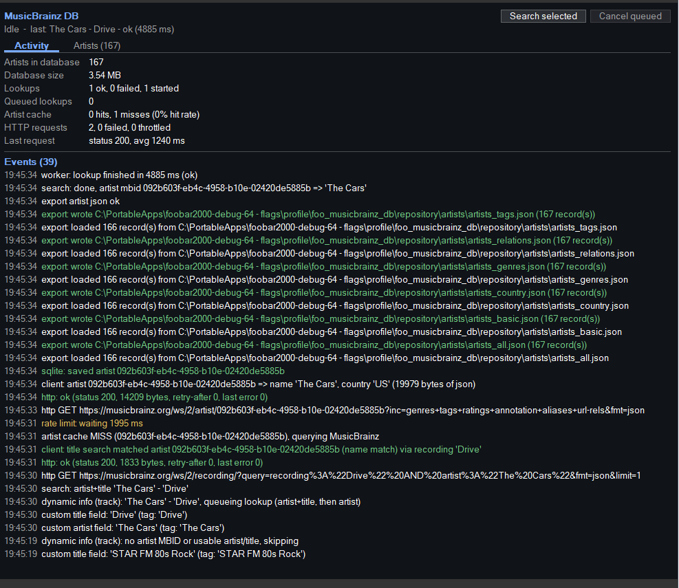
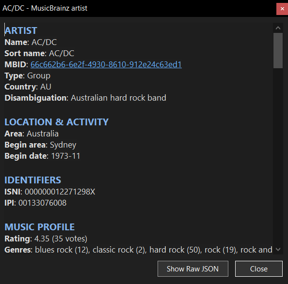

# foo_musicbrainz_db

A foobar2000 component that quietly builds and maintains a local MusicBrainz artist database while you listen. It looks up artists when tracks start or when radio streams publish new track metadata, then caches complete artist records in SQLite and exports them to JSON files.


## Features

### Automatic artist collection

- **Playback-triggered lookups.** A lookup is queued when a new track starts. The component also handles dynamic track metadata, which is commonly used by Shoutcast/Icecast streams.
- **MusicBrainz ID tags take priority.** A valid UUID in `MUSICBRAINZ_ARTISTID` or `MUSICBRAINZ ARTIST ID` is used directly; no artist/title search is needed.
- **Search fallback.** Without an ID, the component searches by recording title and artist, then falls back to an artist-name search. Artist-name results are accepted when the name matches or MusicBrainz reports a very high score.
- **Combined stream titles.** If no artist tag is available, a title in `Artist - Title` form is split into artist and title.
- **Custom tag expressions.** Artist and title can be sourced from user-defined foobar2000 title-formatting patterns instead of the plain `%artist%` and `%title%` metadata fields.
- **Stream metadata settling delay.** Dynamic-info lookups can be delayed by 0–300 seconds. A newer metadata update restarts the delay, so short-lived jingles, adverts or partial metadata updates need not trigger a lookup. The pending delay is cancelled when playback stops or a new track starts.
- **Duplicate suppression.** Repeated dynamic updates with the same artist/title (or artist MBID) are ignored. Batch searches also collapse multiple selected tracks by the same artist into one lookup.
- **Background processing.** Network requests and database work run on a worker thread rather than in playback callbacks. Lookups are queued and processed serially.

### Local data

- **SQLite cache.** A complete artist record is cached by MBID. Subsequent lookups use the local database rather than the network.
- **Complete artist data.** The raw MusicBrainz artist response is retained, including fields such as genres, tags, ratings, annotation, aliases and URL relationships when supplied by MusicBrainz.
- **JSON repository.** The component maintains six split JSON stores alongside the SQLite database.
- **Safe repository updates.** JSON files are written through a temporary file and renamed into place. Existing JSON that cannot be parsed, or is not a JSON object, is not overwritten.
- **Existing database migration.** The component adds the full-response `json` column to an older artists table when needed. Legacy recording tables are removed because recordings are not stored.

### Activity and artist management

The component provides an **Activity** window in both supported foobar2000 UI systems:

- **Default UI:** a utility element named **MusicBrainz DB activity**.
- **Columns UI:** a panel named **MusicBrainz DB activity**, in the **Panels** category.

The window follows the host's light/dark colours and font where available. It has two tabs:

- **Activity:** shows current lookup/task status, database artist count and size, lookup success/failure totals, queued lookups, cache hits/misses and hit rate, HTTP request/failure/throttling counts, last HTTP status and average request duration. It also shows the event feed. Events can be copied or cleared from its context menu.
- **Artists:** browses the artists currently cached in SQLite. The list shows artist name, country and type; clicking a column header sorts by that column. A search box filters by artist name, country or MBID.

The Artists tab supports standard multi-selection (Ctrl-click and Shift-click), keyboard navigation, and these actions:

- **View artist details.** Double-click an artist row to open a dedicated, modeless information window. The window presents the stored MusicBrainz record in readable sections: artist details, location and activity, identifiers (ISNI/IPI), music profile (rating, genres and tags), and annotation. It also includes the complete raw JSON with syntax highlighting. Only one information window is opened per artist; double-clicking that artist again brings its existing window to the front. 																																																																																																																																							   
- **Delete selected** (Delete key or context menu). Removes the selected artist records from SQLite and the corresponding entries in the component's JSON repository.
- **Export selected/all full records.** Saves the complete stored MusicBrainz artist JSON as an object keyed by MBID.
- **Export selected/all list.** Saves a JSON array with each artist's `mbid`, `name`, `country` and `type`.
- **Copy MBID(s)** (Ctrl+C).
- **Select all** (Ctrl+A), **Refresh** (F5), and **Clear selection** (Escape).
- **Search selected** queues a lookup for each distinct artist in the current foobar2000 selection (or the active playlist selection when there is no UI selection). The panel displays batch progress, completed/failed counts, elapsed time and an estimated remaining time while work is in progress.
- **Cancel queued** removes pending lookups from the queue. It does not interrupt an HTTP request already in progress.

There is also a track context-menu command: right-click selected tracks and choose **MusicBrainz DB > Search MusicBrainz for selected artists**.

## Where your data lives

Everything is stored in your foobar2000 profile folder:

```
<profile>\foo_musicbrainz_db\
├── database\
│   └── musicbrainz.sqlite3
└── repository\
    └── artists\
        ├── artists_all.json         complete MusicBrainz artist response
        ├── artists_basic.json       name, sort-name, type, gender, disambiguation,
        │                            life-span, ISNIs and IPIs
        ├── artists_country.json     name, country, area, begin-area, end-area
        ├── artists_genres.json      name and genres
        ├── artists_relations.json   name and URL relationships
        └── artists_tags.json        name and tags
```

Each repository file is a single JSON object keyed by artist MBID. Every record includes its `mbid`. The split files contain only the fields named above; fields absent from the MusicBrainz response are omitted, while the genres, relations and tags arrays are always present (empty when the artist has none).

The repository is maintained as artists are first fetched and when artists are deleted through the Artists tab. The SQLite database is the source used for artist browsing and exports.

## Installation

1. Download `foo_musicbrainz_db.dll` (or a `.fb2k-component` package, if provided).
2. In foobar2000, open **File > Preferences > Components**, click **Install...** and choose the file, or copy the DLL into your profile's `user-components-x64` folder.
3. Restart foobar2000.

After restart, the console (**View > Console**) should show `foo_musicbrainz_db: initialized`. Play a track with usable artist metadata; the Activity window and console will report lookup progress and results.

To add the Activity window:
- **Default UI:** add the **MusicBrainz DB activity** utility element to the layout.
- **Columns UI:** add the **MusicBrainz DB activity** panel from the **Panels** category.

## Settings

Open **Preferences > Tools > MusicBrainz DB**.

| Setting | Description |
|---|---|
| Enable debug logging to the console | Enables detailed diagnostic lines prefixed with `foo_musicbrainz_db [debug]`. Off by default. |
| Artist field | Optional foobar2000 title-formatting pattern used instead of the plain artist metadata field. Empty means use the tag. |
| Title field | Optional title-formatting pattern used instead of the plain title metadata field. Empty means use the tag. |
| Dynamic info delay (seconds) | Waits 0–300 seconds after stream metadata changes before queuing a lookup. Every newer update restarts the wait; `0` looks up immediately. |

Invalid or empty custom patterns fall back to the corresponding plain metadata tag. The preferences page reports invalid patterns. Status messages (initialization, matches and errors) are printed to the console regardless of the debug-logging setting.

## MusicBrainz requests and rate limiting

Requests are made over HTTPS to `musicbrainz.org`. The client spaces requests by at least 1.1 seconds and handles HTTP 429/503 responses with retries and the server's `Retry-After` back-off when provided. HTTP requests use finite connection/send/receive timeouts. The Activity view reports request status, duration, failures and throttling.

Before distributing a build, replace the placeholder contact details in the `User-Agent` string in `src/musicbrainz_client.cpp` with a valid project or maintainer contact. MusicBrainz asks API clients to identify themselves.

## Building

Requirements:

- Visual Studio 2022 (toolset v143), C++17
- foobar2000 SDK, with this project placed in the SDK's `foobar2000` folder as `foo_musicbrainz_db`
- SQLite3 and nlohmann/json (for example via vcpkg)
- WTL (restored through NuGet; the project expects `packages\wtl.10.1.0`)
- The SDK's `shared-x64.lib` / `shared-Win32.lib`
- Columns UI SDK headers/library for the Columns UI panel integration

Open `foo_musicbrainz_db.sln` and build the desired configuration. The project file defines Debug/Release for Win32 and x64; the usual release build is `Release|x64`.

To remove all debug logging from the binary entirely, set `MBDB_DEBUG_LOG` to `0` in `src/debug_log.h` or in the project's preprocessor definitions.

## Programmatic access

Other components and external tools can read the data directly:

- **SQLite:** open `<profile>\foo_musicbrainz_db\database\musicbrainz.sqlite3` read-only (for example with the URI `file:...?mode=ro`). The database uses WAL mode, so reading while foobar2000 is running is supported; use a busy timeout in case a write is in progress. Your component needs its own SQLite copy (statically linked is simplest).
- **JSON:** read the files in `repository\artists\` described above.

The `artists` table has these columns:

| Column | Meaning |
|---|---|
| `mbid` | Artist MusicBrainz ID; primary key |
| `name` | Artist name |
| `type` | Artist type |
| `country` | Country code |
| `area` | Area |
| `begin_area`, `end_area` | Begin/end areas |
| `begin_date`, `end_date` | Begin/end dates |
| `disambiguation` | Disambiguation text |
| `json` | Complete raw MusicBrainz artist response |

Example:

```sql
SELECT country FROM artists WHERE mbid = '<artist mbid>';
```

Please treat the database as read-only and do not write to it. The schema version is stored in `PRAGMA user_version` (currently `1`); check it before relying on the layout. The component currently creates the table and performs its own compatibility migration, but the documented schema version remains `1`.

`include/musicbrainz_db_interface.h` describes a lookup contract (`search_artist_title`, `get_artist_country`, `get_artist_json`). The provider implements this interface internally, but the header explicitly describes it as a conceptual contract: it is not registered as a foobar2000 service and cannot currently be called across components.

`include/musicbrainz_db_types.h` defines the lightweight artist-list row (`mbid`, `name`, `country`, `type`) and artist record, including the full raw JSON response.

## Privacy and network use

The component sends artist names, track titles and/or MusicBrainz artist IDs from the tracks you play to `musicbrainz.org` over HTTPS to identify artists and retrieve artist records. The component stores artist records locally in the profile folder. It does not upload the local database or JSON repository. Nothing else is collected by the author.

## Credits

Metadata is provided by [MusicBrainz](https://musicbrainz.org/) and is available under its own [data licensing terms](https://musicbrainz.org/doc/About/Data_License).

## License

MIT License


### Screenshots




